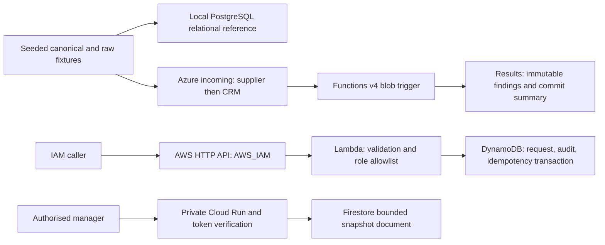
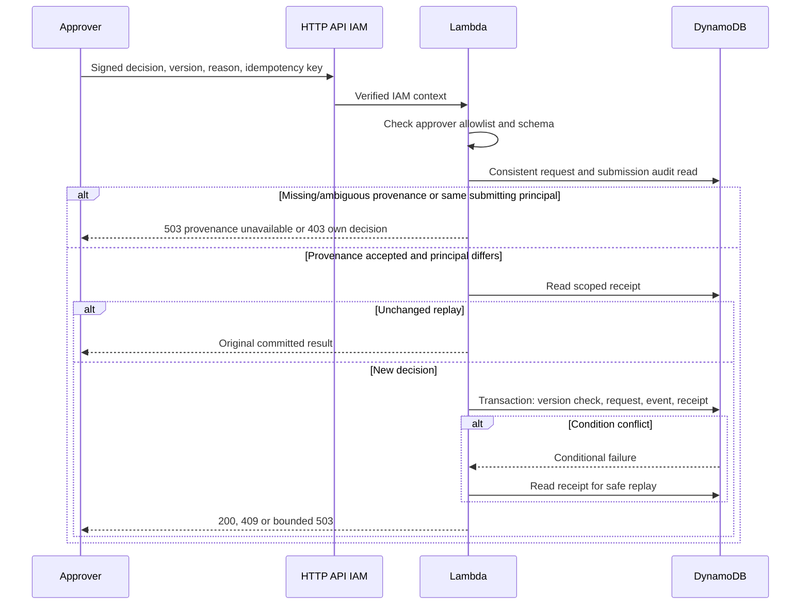
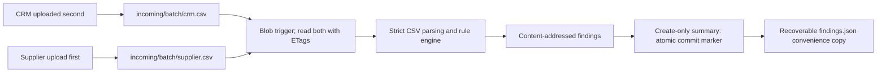
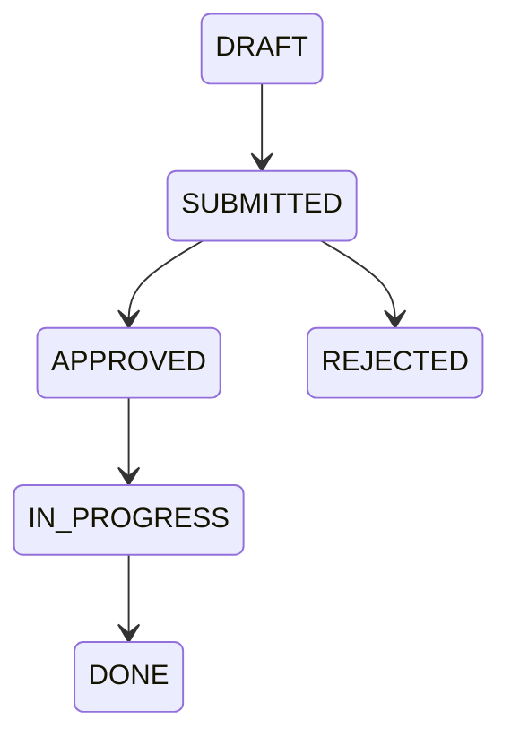

# Implemented architecture and proposed cloud topology

All demonstration data is synthetic. Portfolio project, not an employer integration. AWS and GCP business APIs were deployed in approved temporary runs on 24 October 2026, then removed. Azure cloud remains NOT VERIFIED. GCP's health correction and the new AWS same-principal/provenance controls are local-only changes after their historical deployments.

Only submit and approve/reject transitions are exposed through the AWS MVP. Later transitions are defined and tested in the shared domain for clarity, not claimed as API workflows. Local AWS HTTP uses an in-memory adapter and distinct random requester/approver environment tokens on loopback. Cloud Lambda accepts only API Gateway IAM context. The approval sequence above describes the current local code; the new provenance/principal check was not deployed in the earlier AWS run. Cloud Run independently verifies audience, signature and allowlisted verified email; there are no mutation routes. Firestore uses ADC with a dedicated read-only runtime identity.

The approved Cloud Run run used a shared custom audience at platform/app layers, separate runtime and caller identities, service/revision max one, zero minimum and CPU boost disabled. Actual dual-header smoke used X-Serverless-Authorization for platform IAM and an intact Authorization token for app signature/audience/allowlist checks. Runtime read the dedicated default Firestore database with its service identity. No live lab resource remains. See [actual results](GCP-CLOUD-RESULTS.md) and the [historical approved proposal](GCP-DEPLOYMENT-PROPOSAL.md).
