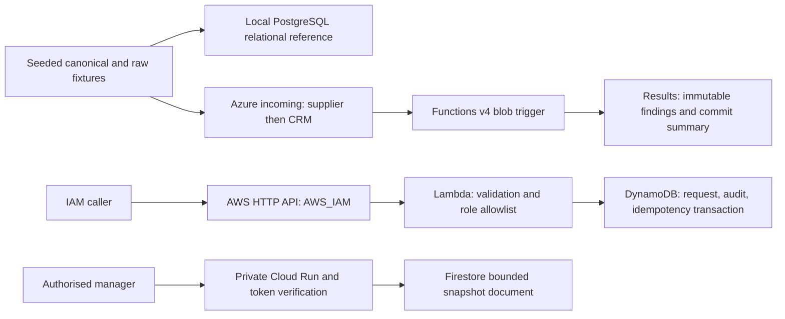
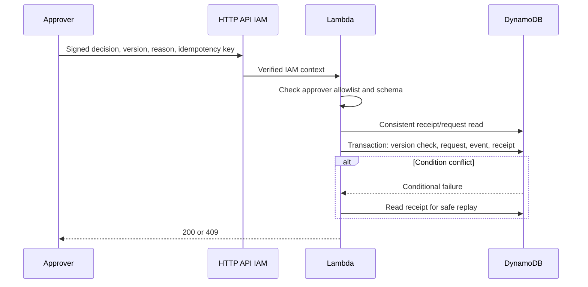
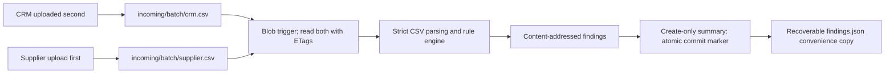
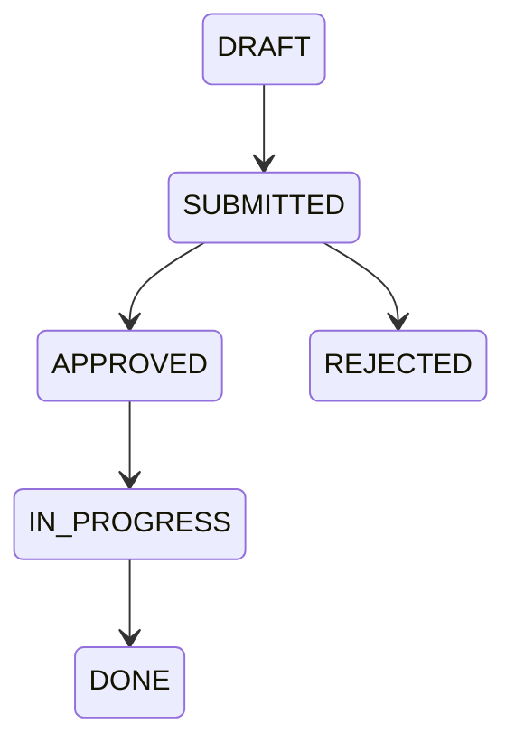

# Implemented architecture and proposed cloud topology

All demonstration data is synthetic. Portfolio project, not an employer integration. AWS nodes were deployed and verified as a temporary demo on 24 October 2026, then removed. Azure and Google Cloud nodes describe locally tested configuration; their live deployment remains unverified.

Only submit and approve/reject transitions are exposed through the AWS MVP. Later transitions are defined and tested in the shared domain for clarity, not claimed as API workflows. Local AWS HTTP uses an in-memory adapter and a random environment token on loopback. Production Lambda accepts only API Gateway IAM context. Cloud Run independently verifies audience, signature and allowlisted verified email; there are no mutation routes. Firestore uses ADC with a dedicated read-only runtime identity.
