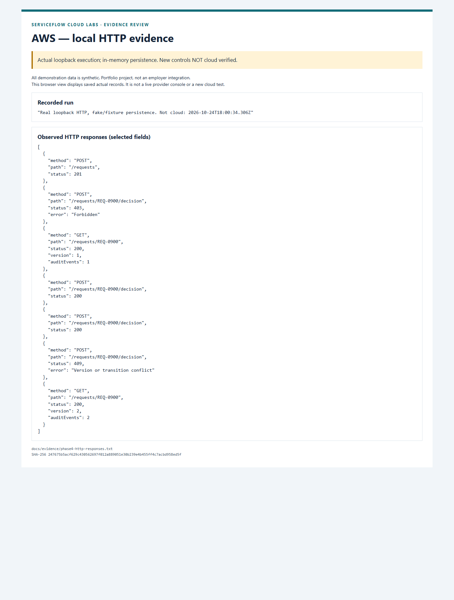

# AWS case study — traceable request approval

All demonstration data is synthetic. Portfolio project, not an employer integration.

**Status:** original cloud feature set VERIFIED on 24 October 2026; dedicated resources removed. Subsequent BA-007/008 hardening is LOCAL ONLY. No production service or independent human approval is claimed.

## Problem, stakeholder and requirement

In this fictional scenario, incomplete intake and unexplained approval decisions prevent a Service Owner from trusting delivery status. An Operations analyst needs a complete request; an Approver needs a versioned decision with a reason; a reviewer needs to trace who changed what. BA-001/002/005 define the intake, audit and access requirements. New BA-007/008 add same-principal exclusion and uncertain-commit recovery.

## Implementation and decisions

API Gateway IAM verifies a signed caller, then the Lambda applies business-role allowlists and strict schemas. A single DynamoDB table fits request-by-ID access without an unnecessary index. One conditional transaction writes request, audit event and idempotency receipt; conflicting versions cannot silently overwrite a decision. Bounded strong reads and actor/path/key-scoped receipts support safe replay. [Architecture and approval sequence](../04-ARCHITECTURE.md), [OpenAPI](../../apps/aws-request-approvals/openapi.yaml), [requirements](../01-REQUIREMENTS-MATRIX.md).

Local hardening derives the submitter from preserved server-written audit evidence, rejects the same principal's own approval/rejection and fails closed if provenance is missing or ambiguous. Tests inject a lost acknowledgement after a real DynamoDB Local commit: the first response is 503, while an unchanged retry recovers the committed result without another event. The local HTTP demo uses separate synthetic requester/approver credentials. These are code changes after the verified cloud run.

## Verification and visual evidence

The approved Stockholm run exercised 15 HTTP calls, including 10 mutation attempts: creation/readback, approval/replay, malformed data, duplicate/stale conflicts, unsigned rejection and signed reader-only rejection. Direct DynamoDB reads verified one approved request, two audit events and two receipts. Regional logging and seven-day retention passed. Seven independent absence checks verified removal of dedicated resources. Deployed source: `e0a49b611d654728a72611ee1a5e7eb571ce4adf`. [Exact historical provider evidence](../evidence/aws-cloud-verification.json).

The image displays saved actual local HTTP results; [source, timestamp and hashes](../evidence/SCREENSHOTS.md) distinguish it from the earlier cloud run. [New execution manifest](../evidence/phase4-verification.json), [readiness tests](../../apps/aws-request-approvals/tests/readiness.test.ts), [persistence acceptance](../../apps/aws-request-approvals/tests/dynamodb.integration.test.ts).

## Costs, limitations and next steps

The approved demo retained the Free plan and was removed; delayed final billing is unverified. One owner exercised all original cloud roles. Managed project grants prevent an effective least-privilege claim, and different session IDs may belong to the same human. No load, backup/restore or production availability result is inferred from a small smoke test. [Cost gate](../COST_GATE.md), [prioritised production backlog and recovery playbook](../AWS-PRODUCTION-READINESS.md).

Lesson: identity verification, business permission, concurrency and an auditable outcome are distinct acceptance criteria. A timeout does not prove that a write failed. Next: agree operational targets and stable identity/retention policy, then verify recovery and permissions through a separately approved release.
