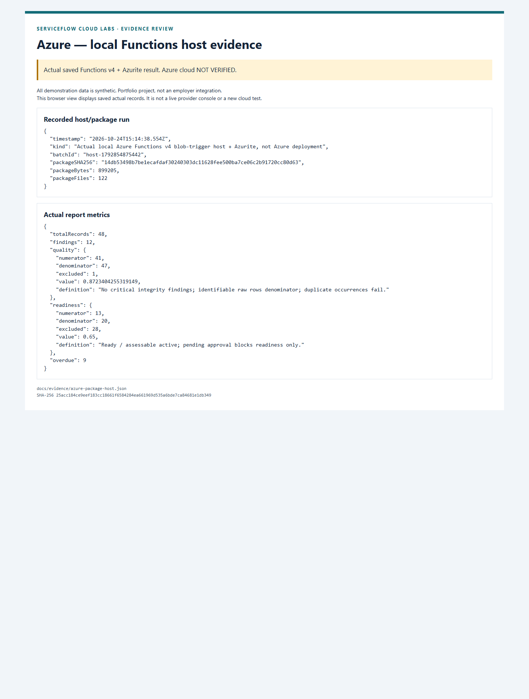

# Azure case study — inspectable source reconciliation

All demonstration data is synthetic. Portfolio project, not an employer integration.

**Status: LOCAL PASS; Azure cloud NOT VERIFIED.** No Azure application/storage resources were deployed. Credit visibility is resolved privately; Y1 entitlement still blocks the selected plan. No paid upgrade or deployment approval exists.

## Problem, stakeholder and requirement

A fictional Delivery Coordinator receives conflicting CRM and supplier updates. A Data Steward needs to see the original values, rule, affected row and owner instead of receiving a silently repaired spreadsheet. BA-003 requires preserved sources and reproducible exceptions; BA-006 keeps data quality distinct from legitimate approval waits and delivery slippage. [Data dictionary/source map](../03-DATA-DICTIONARY.md), [acceptance criteria](../02-USER-STORIES-AND-ACCEPTANCE.md).

## Implementation and decisions

Supplier CSV is uploaded first, CRM second; the CRM Blob trigger invokes Functions v4. Parsing enforces 1 MiB/200-row limits, types and explicit source rules. SHA-256 and ETags bind results to source bytes. Content-addressed findings are immutable; a create-only summary containing the full report is the commit point. A replay can repair the convenience findings copy, while changed sources under a committed batch conflict. [Implemented data flow](../04-ARCHITECTURE.md), [source](../../apps/azure-data-quality/README.md).

Blob files fit this bounded batch without an extra queue or database. Multiple Blob writes are not an atomic database transaction: immutable batch discipline and summary-last publication are explicit controls. The local host test exposed a .NET/Node emulator-port mismatch; an allowlisted local Blob endpoint corrected it. The failed batch produced no false PASS.

## Verification and visual evidence

The reproducible ZIP contains 122 files, 899205 bytes, SHA-256 `14db53498b7be1ecafdaf30240303dc11628fee500ba7ce06c2b91720cc80d63`. Byte-for-byte rebuild, CRC/root checks and a local-settings exclusion probe passed. That exact ZIP ran in a real local Node 22 Functions v4 host against Azurite and produced the expected 48-record/12-finding report. Eight CRM rows are intentionally affected; overlapping rules explain why findings exceed affected rows. [Exact host/package evidence](../evidence/azure-package-host.json), [configuration/runbook](../AZURE-PACKAGE-AND-STORAGE.md).

[Screenshot provenance](../evidence/SCREENSHOTS.md). The report is a saved local host result, not an Azure portal screenshot. Unit/integration tests cover missing sources, duplicates, malformed values, retries, conflicting batch reuse and partial output writes.

## Costs, limitations and next steps

Read-only account checks verify Free Trial/Enabled/spending limit On and privately verify current promotional credit and direct expiry. Ten regional usage reads found six explicit Y1 zero limits and four omitted entries; no usable allocation was established. Only the earlier owner-approved Microsoft.Web registration changed subscription setup. The owner has an unsent included billing/subscription-support draft. [Current no-upgrade findings](../AZURE-NO-UPGRADE-OPTIONS.md), [redacted recheck](../evidence/azure-free-recheck.json), [cost gate](../COST_GATE.md).

The private Blob package/user-assigned identity design compiles locally; cloud managed identity, startup/package access, storage-trigger behaviour and observability remain unverified. Functions execution grants do not make storage unconditionally free. Next: Microsoft's entitlement clarification; only if the cost/eligibility gate passes, prepare a new exact proposal and obtain approval for live verification. Retain the local lab if paid conversion is required.
