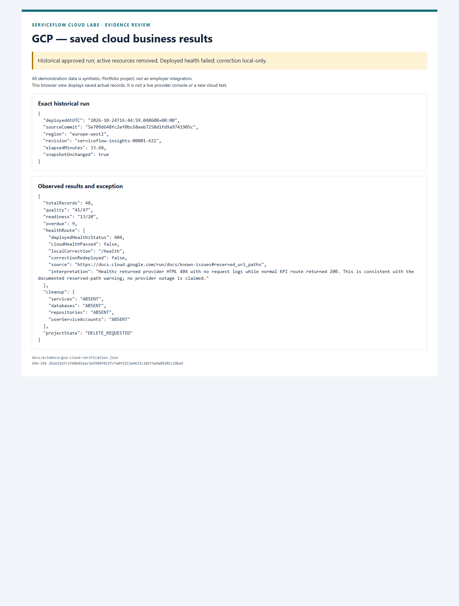

# Google Cloud case study — explainable delivery insights

All demonstration data is synthetic. Portfolio project, not an employer integration.

**Status:** cloud business API VERIFIED in the approved temporary London run; active resources removed and project DELETE_REQUESTED. Deployed `/healthz` failed; the `/health` correction passed locally and was **not redeployed**.

## Problem, stakeholder and requirement

A fictional Manager needs to distinguish data defects, pending decisions and late delivery. BA-004/006 require transparent snapshot metrics, exclusions and record-backed follow-up actions. A correctly recorded pending approval blocks readiness without failing quality. [Metric catalogue](../06-KPI-CATALOGUE.md), [independent SQL reference](../../db/queries/reference.sql).

## Implementation and decisions

A non-root Node/Fastify image exposes read-only KPI, finding and insight routes. Firestore stores one bounded synthetic snapshot; its runtime identity is read-only. Cloud Run platform IAM and application signature/audience/verified-email checks form separate boundaries. In the verified run, dual headers preserved the app token while platform IAM authenticated the caller. No service-account JSON key was committed. [Architecture](../04-ARCHITECTURE.md), [implementation](../../apps/gcp-delivery-insights/README.md).

An explicit UTC `asOf` makes tests reproducible. Responses disclose numerators, denominators and exclusions; zero denominators produce null. The fixture reference is quality 41/47, readiness 13/20, overdue 9 and on-time completion 0/7. The 48-row sample does not establish warehouse scale or commercial impact.

## Verification and visual evidence

The approved trial-only run used one private Cloud Run service/image/revision, one Firestore snapshot and a private registry. Deployed source: `5e709d648fc2ef0bc68eeb7258d1fd9a9741905c`. Live auth/KPI/filter/insight and unchanged-snapshot checks passed. The 28 HTTP attempts include failed diagnostics; they are not 28 passing assertions. Initial seeder platform-403 tests did not prove app-level denial; the separate dual-header test supplied that evidence. [Full actual results](../GCP-CLOUD-RESULTS.md), [provider/test projection](../evidence/gcp-cloud-verification.json).

[Screenshot provenance](../evidence/SCREENSHOTS.md). This is a browser view of the saved redacted provider/test record, not a fresh cloud console or a live endpoint.

## Failure, costs and next steps

The provider returned HTML 404 for `/healthz` while `/kpis` worked. The `/health` correction passed local HTTP and a 256 MiB non-root container/emulator retry; the first container timeout remains recorded. No second image/revision was deployed. Four independent active-resource absence lists passed; project deletion was requested within 33.68 minutes. Deletion recovery/log retention still apply; permanent erasure is not claimed.

Final read-only billing refresh retained Free Trial; credit/dates are private and delayed final billing is unverified. The gross cost scenario is a model, not measured consumption or savings. [Cost gate](../COST_GATE.md). No standing redeploy approval exists. Next: a separately proposed/approved bounded run if cloud verification of the health fix is desired. There is no claim of role-aware analytics, independent human segregation, production availability or commercial savings.
